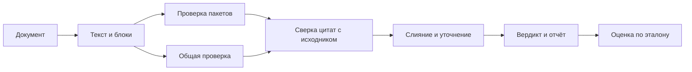
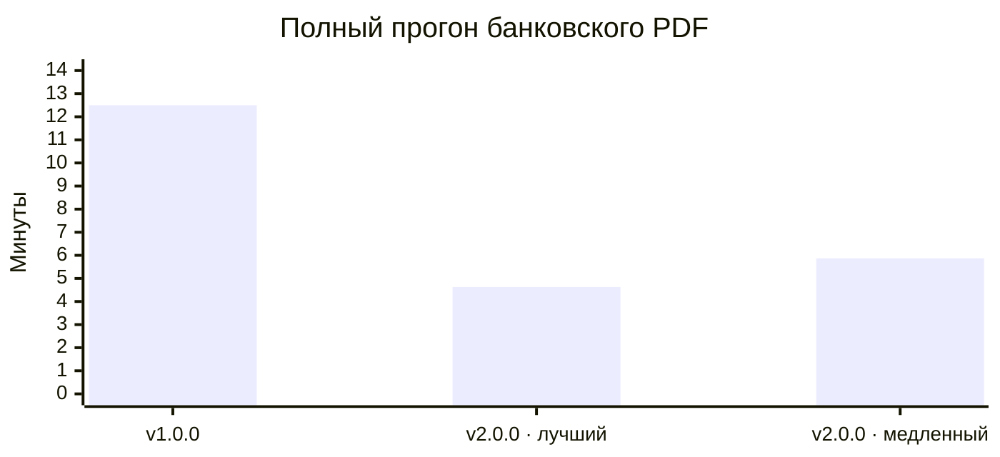

# Агент проверки требований BCC-HUB × MNU FinTech

[](https://github.com/beriktassuly/requirements-validator/actions/workflows/ci.yml)

CLI проверяет ТЗ в PDF, Markdown, DOCX и TXT и формирует отчёт на русском с цитатами и координатами. Рубрика охватывает отдельные требования и связи внутри документа. [Задание](https://github.com/BCC-HUB/ai-requirements-validator-task#readme) · [Архитектурные решения](docs/DECISIONS.md)

## Веб-интерфейс

Из корня проекта запустите Docker Compose.

```sh
docker compose up --build
```

Откройте [Requirements Validator](http://localhost:8000). Кнопки «Открыть пример» и «Воспроизвести прогон» используют сохранённый банковский отчёт и журнал. Они доступны без ключа и не отправляют запросы провайдеру. Из отчёта можно перейти к цитате и скачать Markdown, JSON или автономный HTML. Сохранённый JSON можно открыть отдельно.

**Новый анализ с ключом.** Задайте рабочий `OPENAI_API_KEY` в окружении или скопируйте `.env.example` в `.env` и заполните ключ там. Если контейнер уже запущен, выполните `docker compose up -d --force-recreate` в том же проекте Compose. Затем выберите файл, подтвердите отправку текста и нажмите «Запустить анализ». Сервер проверит загруженный документ тем же валидатором, что и CLI, и сформирует новый отчёт из результатов запросов к провайдеру. Вызовы расходуют квоту проекта и могут списывать средства. Без ключа запуск недоступен.

[Настройки провайдера](docs/CONFIGURATION.md) · [Подробности запуска и приёмки](IMPLEMENTATION_REPORT.md)

## Быстрый старт

Установите Python 3.15.2 и выполните команды PowerShell из корня проекта. [Установка на Linux и macOS](docs/CONFIGURATION.md#установка)

```powershell
py -3.15 -m venv .venv
.\.venv\Scripts\python.exe -m pip install -r requirements.txt
Copy-Item .env.example .env
```

Впишите ключ OpenAI в `OPENAI_API_KEY` в файле `.env`. Положите PDF с текстовым слоем в `input/requirements.pdf` или укажите свой файл. [Получить ключ OpenAI](https://platform.openai.com/api-keys)

```powershell
.\.venv\Scripts\python.exe -m reqvalidator input/requirements.pdf reports/review.md --json-output reports/review.json
```

Результат сохраняется в `reports/review.md`, данные для оценщика — в `reports/review.json`. Каталог создаётся автоматически.

## Примеры отчётов

| Прогон | Версия | Отчёт |
|---|---|---|
| Для сдачи — `v2.0.0`, OpenAI без дополнительных режимов, 5:52 | `7a73ea2` в паспорте | [Markdown](reports/submission.md) · [JSON](reports/submission.json) · [Оценка](reports/pr3-g13-fix/7a73ea2/pdf-1/semantic.json) |
| Предыдущий отчёт для сдачи | [`v1.0.0`](https://github.com/beriktassuly/requirements-validator/tree/v1.0.0) (`0fd8b02` в паспорте) | [Markdown](https://github.com/beriktassuly/requirements-validator/blob/v2.0.0/reports/submission.md) · [JSON](https://github.com/beriktassuly/requirements-validator/blob/v2.0.0/reports/submission.json) |
| OpenAI с `--reviewers qa,api --external-docs` | `f56a59c` | [Markdown](reports/pr3-openai-f56a59c/review.md) |

## Как это работает



- Рубрика опирается на ISO/IEC/IEEE 29148. Каждая цитата сверяется с исходником до включения в отчёт.
- Независимые запросы выполняются параллельно с общим ограничителем частоты.
- Вердикт о готовности рассчитывается кодом. Отдельный оценщик сопоставляет находки с эталоном.

## Скорость и качество



OpenAI без дополнительных режимов: около **12:30 → 4:38–5:52** в трёх прогонах, ускорение **в 2–3 раза**. В каждом — **17/19** по семантической оценке и **5/5** ключевых случаев. В отчёте для сдачи подтверждены **195/195 цитат (100%)**. Результаты повторных запусков могут различаться.

## Docker

Создайте `.env`, как в быстром старте, затем выполните команды из корня проекта.

```powershell
docker build -t bcc-reqvalidator:2.0.1 .
docker run --rm --env-file .env -v "${PWD}:/io" bcc-reqvalidator:2.0.1 /io/input/requirements.pdf /io/reports/review.md --json-output /io/reports/review.json
```

## Настройки и режимы

- **Gemini.** У проверенного бесплатного проекта было 20 запросов в день для модели, а полный банковский PDF потребовал около 26 вызовов. Для полного PDF нужен платный проект с достаточной квотой, для бесплатного подойдёт короткий документ. [Настройка Gemini и квоты](docs/CONFIGURATION.md#gemini).
- **Параллельность.** `--concurrency` или `REQVALIDATOR_CONCURRENCY` задаёт 1–8 одновременных запросов, по умолчанию — 3. [Настройки, форматы ответа и паспорт прогона](docs/CONFIGURATION.md).
- **Дополнительные режимы.** Прогресс, замеры, экспорт находок до слияния, роли QA и API, внешняя документация и `rewrite`. [Флаги и команды](docs/MODES.md#дополнительные-режимы).
- **Проверка результата.** Фикстуры, тесты без ключа, проверка цитат и оценка по эталону. [Тесты и оценщик](docs/MODES.md#фикстуры-тесты-и-оценка).
